# randomquotes

Aplicación Express que responde una frase aleatoria en `/`, junto con el hostname del contenedor que atendió la petición y la versión desplegada. Proyecto de los tutoriales 06 y 07 de Arquitectura de Software (EAFIT).

Autor: Juan José Acevedo Otálvaro

## Tutorial 07: microservicios con Docker y AWS

El servicio corre como contenedores en **Amazon ECS sobre Fargate**, con la imagen almacenada en **Amazon ECR**, cuatro réplicas detrás de un **Application Load Balancer** y despliegue continuo con **GitHub Actions**.

### Arquitectura

```text
git push (main)
   │
   ▼
GitHub Actions ──build/push──► ECR: randomquotes:latest y :<sha del commit>
   │
   └──update-service --force-new-deployment──► ECS randomquotes-service
                                                   │ (4 tareas Fargate)
Cliente ──HTTP:80──► ALB randomquotes-alb ──► target group (tipo IP) ──► tareas :80
```

| Recurso | Nombre | Configuración |
|---|---|---|
| Repositorio de imágenes | `randomquotes` (ECR) | us-east-1 |
| Cluster | `randomquotes-cluster` | solo Fargate |
| Task definition | `randomquotes-task` | Linux/X86_64, 0.25 vCPU, 0.5 GB, puerto 80, rol de ejecución `LabRole`, logs en CloudWatch |
| Security group del ALB | `randomquotes-alb-sg` | entrada HTTP 80 desde `0.0.0.0/0` |
| Security group de las tareas | `randomquotes-task-sg` | entrada HTTP 80 solo desde `randomquotes-alb-sg` |
| Target group | `randomquotes-targets` | tipo IP, HTTP 80, health check en `/` |
| Load balancer | `randomquotes-alb` | público, 6 zonas de us-east-1, listener HTTP:80 |
| Servicio | `randomquotes-service` | réplica, 4 tareas deseadas, IP pública activada, sin autoescalado |

Las tareas solo aceptan tráfico que venga del ALB, porque la regla de entrada de `randomquotes-task-sg` usa como origen el security group del balanceador y no un rango de IPs.

### Entorno

Se usó el **AWS Academy Learner Lab**. Eso obligó a tres ajustes respecto a la guía:

- No se pueden crear roles IAM, así que la task definition usa el rol existente `LabRole` como rol de ejecución.
- Por la misma razón no se pudo configurar OIDC entre GitHub y AWS. El workflow usa como secrets del repositorio las credenciales temporales del lab (`AWS_ACCESS_KEY_ID`, `AWS_SECRET_ACCESS_KEY`, `AWS_SESSION_TOKEN`). Esas credenciales vencen al terminar cada sesión del lab y hay que actualizarlas antes de volver a desplegar. En una cuenta normal lo correcto es OIDC, que no guarda credenciales de larga duración en GitHub.
- La terminal integrada del lab usa otra cuenta y no tiene permisos sobre Docker, así que la imagen se construyó desde **CloudShell** dentro de la consola.

### Despliegue manual inicial

Desde CloudShell:

```bash
aws ecr create-repository --repository-name randomquotes --region us-east-1
git clone https://github.com/jjacevedo/randomquotes.git && cd randomquotes
docker build -t 797895987420.dkr.ecr.us-east-1.amazonaws.com/randomquotes:latest .
aws ecr get-login-password --region us-east-1 | docker login --username AWS --password-stdin 797895987420.dkr.ecr.us-east-1.amazonaws.com
docker push 797895987420.dkr.ecr.us-east-1.amazonaws.com/randomquotes:latest
```

El cluster, la task definition, los security groups, el target group, el ALB y el servicio se crearon desde la consola con la configuración de la tabla anterior.

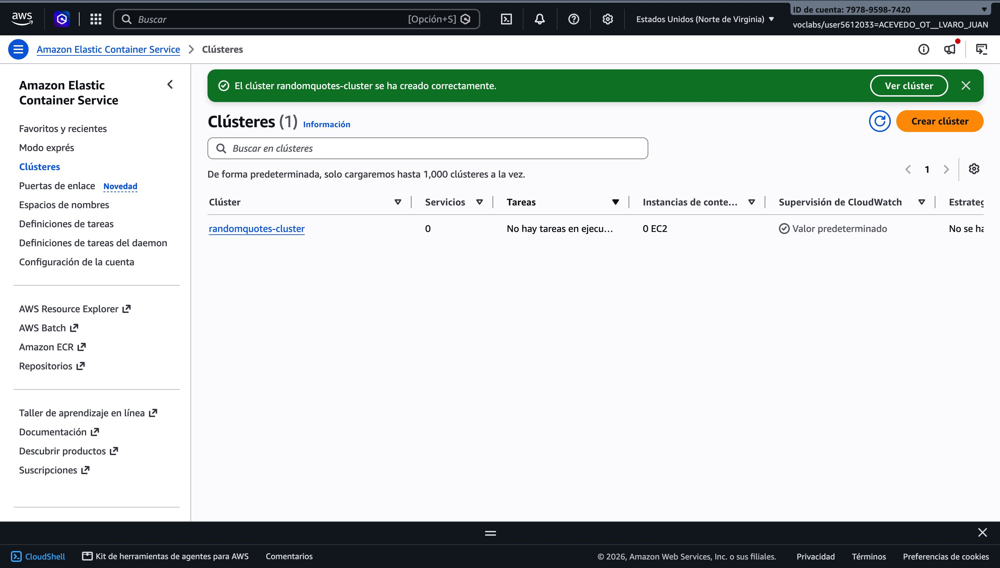

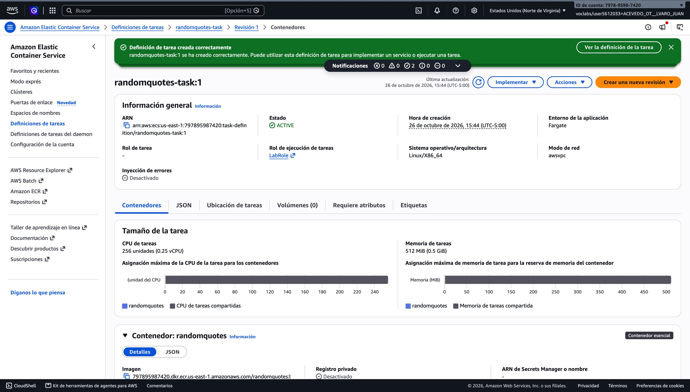

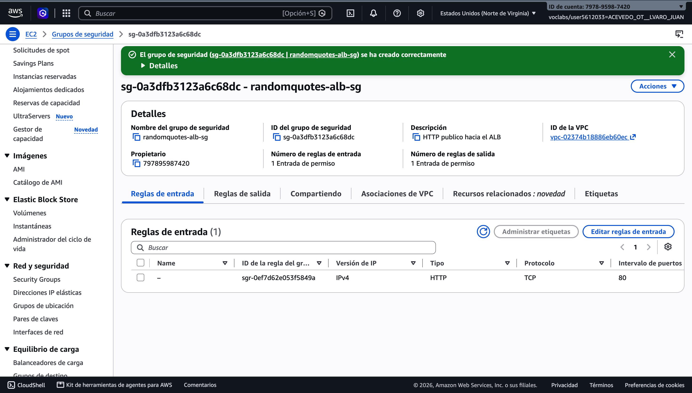

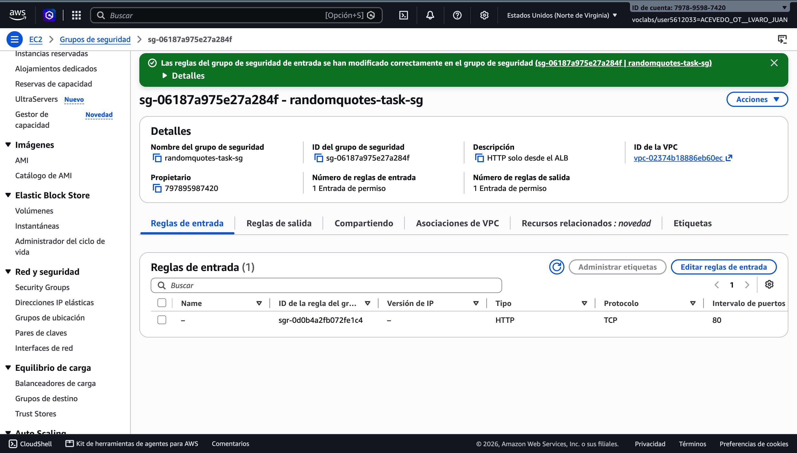

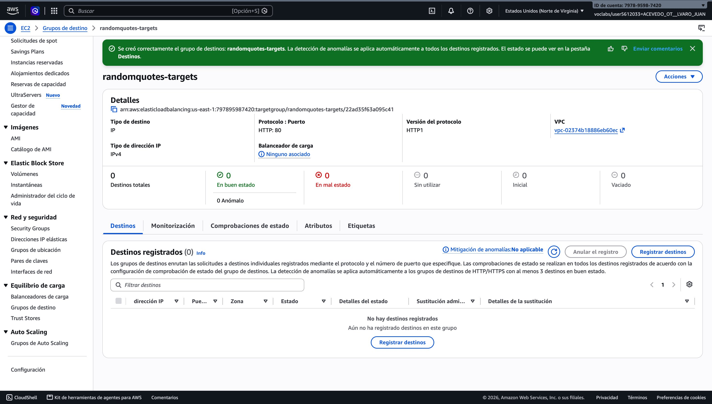

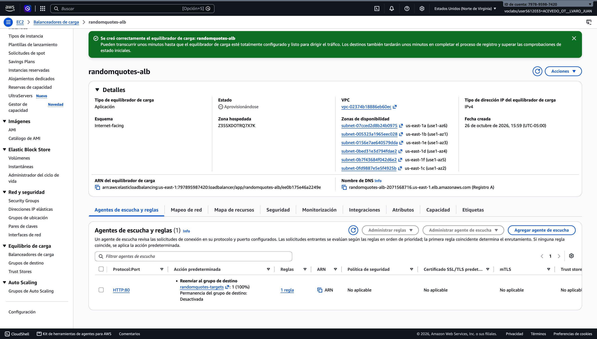

### Problema encontrado: las tareas no podían descargar la imagen

Las primeras tareas se detenían con `TaskFailedToStart`:

```text
ResourceInitializationError: unable to pull secrets or registry auth ...
Post "https://api.ecr.us-east-1.amazonaws.com/": dial tcp 44.213.79.86:443: i/o timeout
```

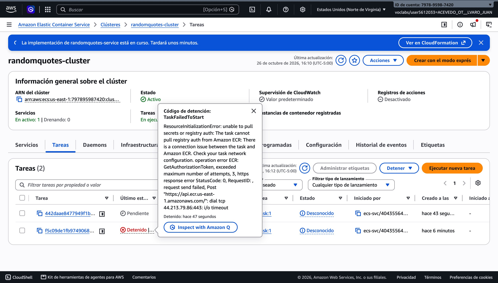

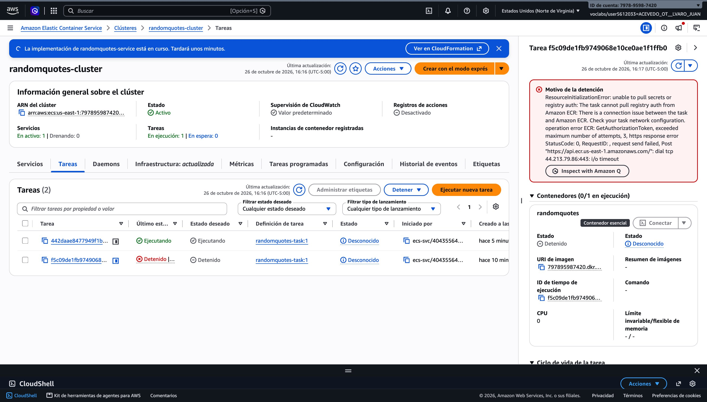

El diagnóstico se hizo por descarte:

1. `assignPublicIp` estaba en `ENABLED`, así que no faltaba la IP pública.
2. La regla de **salida** de `randomquotes-task-sg` no era la de por defecto: solo permitía TCP 443 hacia el security group del ALB. Las tareas no podían salir a internet para pedir el token de ECR, y por eso el error era un timeout y no un permiso denegado.

La corrección fue permitir toda la salida y quitar la regla incorrecta:

```bash
aws ec2 authorize-security-group-egress --group-id sg-06187a975e27a284f --ip-permissions 'IpProtocol=-1,IpRanges=[{CidrIp=0.0.0.0/0}]'
aws ec2 revoke-security-group-egress --group-id sg-06187a975e27a284f --ip-permissions 'IpProtocol=tcp,FromPort=443,ToPort=443,UserIdGroupPairs=[{GroupId=sg-0a3dfb3123a6c68dc}]'
```

Esto no debilita la seguridad: lo que protege a las tareas son las reglas de entrada, que siguen aceptando solo tráfico del ALB. Después de varios fallos seguidos ECS espacia los reintentos, así que se forzó un despliegue nuevo con `aws ecs update-service --force-new-deployment` para no esperar.

### Cuatro tareas en ejecución

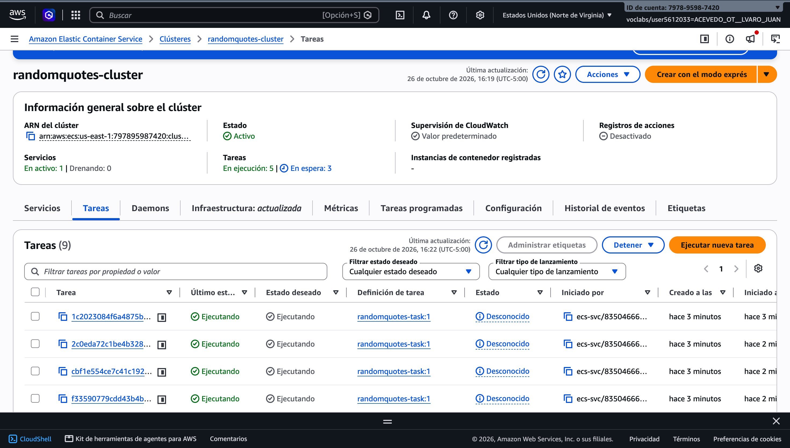

### Prueba de balanceo

Doce peticiones al DNS del ALB:

```bash
for i in $(seq 1 12); do curl -s http://randomquotes-alb-2071568716.us-east-1.elb.amazonaws.com; echo; done
```

```text
Get ready to be inspired… - Container Id: ip-172-31-32-205.ec2.internal
See rejection as redirection. - Container Id: ip-172-31-60-46.ec2.internal
Maybe life is testing you. Don't give up. - Container Id: ip-172-31-6-54.ec2.internal
You can't be late until you show up. - Container Id: ip-172-31-6-54.ec2.internal
You can't be late until you show up. - Container Id: ip-172-31-95-174.ec2.internal
Get ready to be inspired… - Container Id: ip-172-31-32-205.ec2.internal
There is beauty in simplicity. - Container Id: ip-172-31-6-54.ec2.internal
Impossible is just an opinion. - Container Id: ip-172-31-95-174.ec2.internal
Get ready to be inspired… - Container Id: ip-172-31-60-46.ec2.internal
Impossible is just an opinion. - Container Id: ip-172-31-60-46.ec2.internal
You can't be late until you show up. - Container Id: ip-172-31-32-205.ec2.internal
Maybe life is testing you. Don't give up. - Container Id: ip-172-31-6-54.ec2.internal
```

Respondieron los cuatro contenedores (4, 3, 3 y 2 respuestas). El reparto no es exacto porque el ALB tiene un nodo por zona y cada nodo hace su propio round robin, así que en una muestra pequeña la distribución no queda pareja.

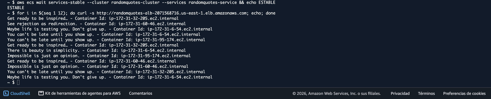

### Prueba de detención y recuperación

Se detuvo manualmente la tarea `1c2023084f6a4875be3625cc154a3708` desde la consola.

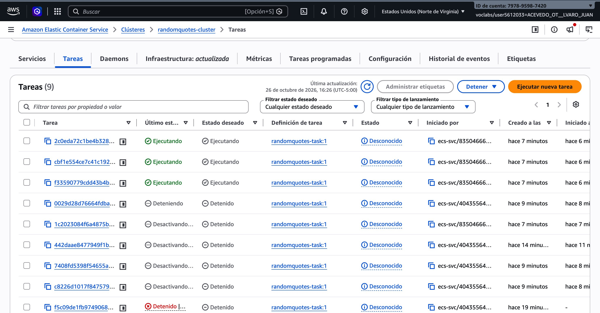

Eventos del servicio (UTC):

| Hora | Evento |
|---|---|
| 21:26:37.031 | sale la tarea del target group |
| 21:26:37.036 | empieza el drenado de sus conexiones |
| 21:26:37.996 | lanza la tarea de reemplazo `e17ed9ec85b94a309ba35c42f51e2fef` |
| 21:27:07.598 | registra la tarea nueva en el target group |
| 21:27:16.476 | el servicio vuelve al estado estable con 4 tareas |

La recuperación tomó unos 39 segundos sin intervención manual. Durante ese tiempo el ALB siguió atendiendo con las otras tres tareas.

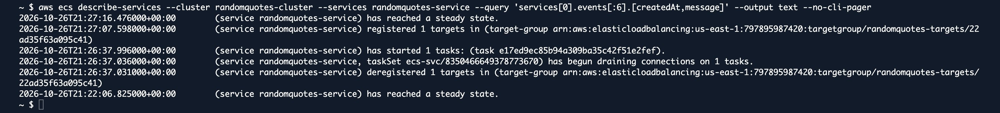

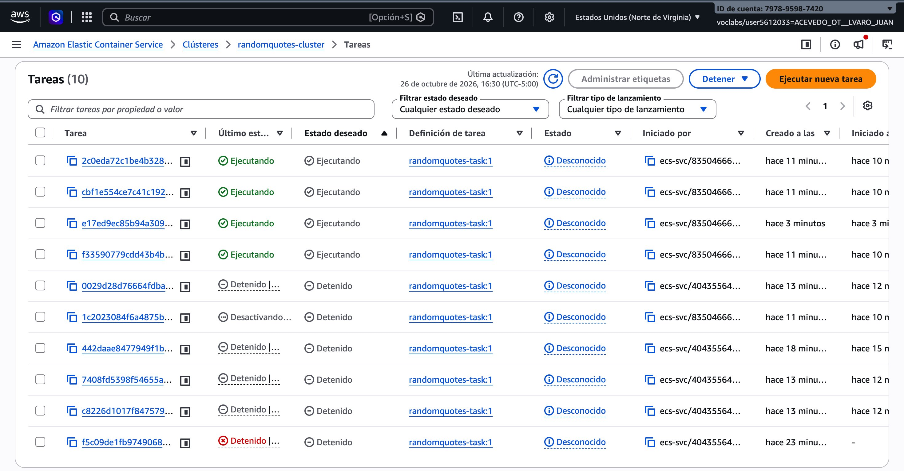

### Despliegue continuo con GitHub Actions

El workflow [`.github/workflows/deploy.yml`](.github/workflows/deploy.yml) se ejecuta con cada push a `main` o manualmente desde la pestaña Actions:

1. Descarga el código.
2. Carga las credenciales desde los secrets.
3. Imprime el Account ID para confirmar la cuenta.
4. Inicia sesión en ECR.
5. Construye la imagen con dos tags, `latest` y el SHA del commit, y la sube.
6. Fuerza un nuevo despliegue del servicio y espera a que quede estable. El job solo sale exitoso si las tareas nuevas pasan los health checks.

El tag por commit permite saber qué versión está desplegada y volver a una anterior si hace falta. Se agregó un `.dockerignore` para no copiar `.git`, `node_modules`, las capturas ni el README dentro de la imagen.

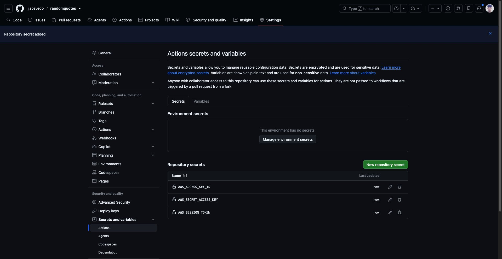

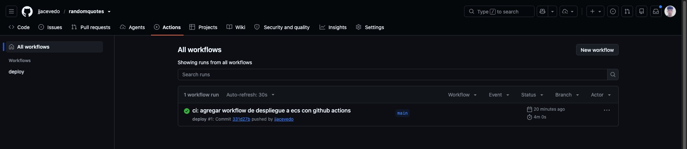

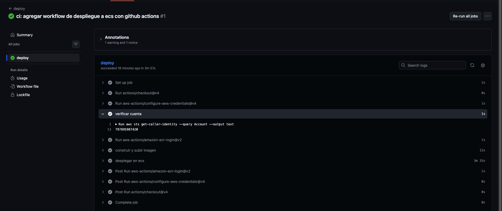

Para comprobar el flujo completo se cambió la respuesta para incluir `Version: 2.0` (commit `ced3df0`) y se hizo push mientras CloudShell consultaba el ALB cada 10 segundos:

```text
23:26:37 See rejection as redirection. - Container Id: ip-172-31-76-180.ec2.internal
23:26:47 Impossible is just an opinion. - Container Id: ip-172-31-41-108.ec2.internal
23:26:57 Maybe life is testing you. Don't give up. - Container Id: ip-172-31-83-48.ec2.internal - Version: 2.0
23:27:07 Alone or not you gonna walk forward. - Container Id: ip-172-31-83-48.ec2.internal - Version: 2.0
23:27:17 Impossible is just an opinion. - Container Id: ip-172-31-38-93.ec2.internal - Version: 2.0
23:27:27 See rejection as redirection. - Container Id: ip-172-31-31-100.ec2.internal - Version: 2.0
23:27:37 Impossible is just an opinion. - Container Id: ip-172-31-12-84.ec2.internal - Version: 2.0
```

De 34 consultas ninguna falló. La versión nueva empezó a responder unos dos minutos después del push, desde cuatro contenedores distintos a los anteriores.

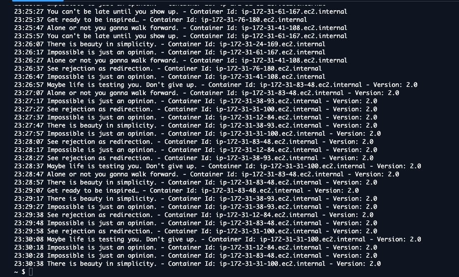

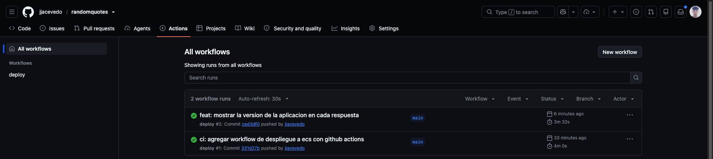

En ECR quedaron la imagen subida a mano (sin tag, porque perdió `latest`) y las dos subidas por el workflow, cada una con el SHA de su commit:

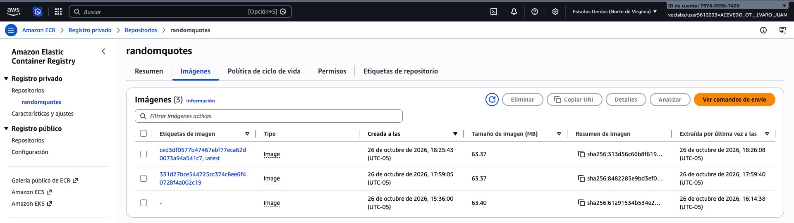

### Conclusiones

- ECS mantiene el estado deseado por sí solo. Al detener una tarea, el servicio la reemplazó en menos de un segundo y volvió a 4 tareas sanas en unos 39 segundos, sin que el ALB dejara de responder.
- El ALB y el target group de tipo IP desacoplan a los clientes de los contenedores. Las IPs de las tareas cambian en cada despliegue, pero el DNS del balanceador es siempre el mismo.
- El despliegue con `--force-new-deployment` reemplaza las tareas de forma gradual: levanta las nuevas, espera los health checks y solo entonces retira las viejas. Por eso no hubo caída al pasar a la versión 2.0.
- Con GitHub Actions, llevar un cambio a producción se reduce a un `git push`. El workflow repite exactamente los comandos que antes se hacían a mano en CloudShell.
- En un security group importan tanto la entrada como la salida. Una regla de salida demasiado restrictiva impidió descargar la imagen, y el síntoma fue un timeout de red, no un error de permisos.
- Las restricciones del Learner Lab (sin roles IAM, credenciales temporales) se resolvieron con `LabRole` y secrets temporales. En un entorno real se debería usar OIDC.

### Observaciones

- GitHub avisa que `actions/checkout@v4` y `aws-actions/configure-aws-credentials@v4` están hechas para Node.js 20 y ahora se ejecutan sobre Node.js 24. El workflow funciona, pero conviene actualizarlas a versiones nativas de Node.js 24.
- Las tareas tienen IP pública porque la VPC por defecto no tiene NAT Gateway. Con subredes privadas y NAT, o con endpoints de VPC para ECR y CloudWatch, las tareas no necesitarían IP pública.

### Limpieza

Al terminar se eliminaron los recursos del taller:

```bash
aws ecs update-service --cluster randomquotes-cluster --service randomquotes-service --desired-count 0
aws ecs delete-service --cluster randomquotes-cluster --service randomquotes-service --force
aws elbv2 delete-load-balancer --load-balancer-arn <arn del alb>
aws elbv2 delete-target-group --target-group-arn <arn del target group>
aws ecs delete-cluster --cluster randomquotes-cluster
aws ecr delete-repository --repository-name randomquotes --force
aws ec2 delete-security-group --group-id sg-06187a975e27a284f
aws ec2 delete-security-group --group-id sg-0a3dfb3123a6c68dc
aws logs delete-log-group --log-group-name /ecs/randomquotes-task
```

## Tutorial 06: despliegue en una máquina virtual

Primera versión del proyecto: la aplicación se empaquetó con Docker y se desplegó en la instancia EC2 compartida del grupo (Amazon Linux 2023, t3.micro).

```bash
docker build -t randomquotes-juan-acevedo:1.0 .
docker run -d --name randomquotes-juan-acevedo --restart unless-stopped -p 80:80 randomquotes-juan-acevedo:1.0
```


## Ejecutar localmente

```bash
npm install
node index.js
```

La aplicación escucha en el puerto `80`.
